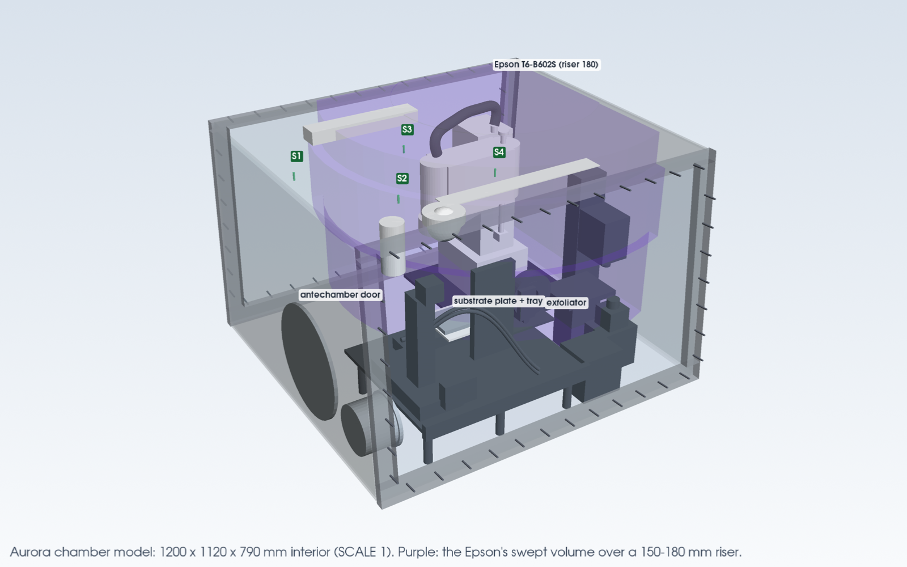

# Aurora chamber model

A measured, simplified model of the Aurora PCL glovebox (the Borys group's exfoliation box) that any
design in this repo can import: the box and its sloped windows, the window flanges and their welded
studs, the ceiling studs S1-S4, the antechamber doors, the exfoliator with its substrate plate and chip
tray, and the Epson T6-B602S SCARA with its cable duct and swept volume. It also has checks for a part's
clearance to the robot and for what a camera sees.



## Where the numbers come from

Positions were measured on a metric 3D reconstruction of the in-person walkthrough video (issue #23).
It came in three drops in `sgbaird/agent-staging`, under `for/borysgroup/aurora-cloud-infra/`:

| Drop | What it holds |
|---|---|
| `2026-11-07-aurora-glovebox-3d/` | dense point cloud, mesh, 649 solved camera poses, renders |
| `2026-11-06-aurora-camera-mount-keyframes/` | 21 annotated keyframes (corrected in agent-staging `50d0fc5`: the Epson stands on a riser, it is not ceiling-mounted) |
| `2026-11-07-aurora-recon-writeup-and-scripts/` | reconstruction write-up, pipeline scripts, the nearest solved pose for each annotated keyframe, the riser note |

**The recording is private and this repo is public.** Only derived numbers and renders of the simplified
geometry are committed here. The frames, point cloud, mesh, pose files and write-up are not, and must not be.
Re-measuring needs the drops. Fetch them only when Sterling points you to them, into `/tmp`, following the
root `CLAUDE.md`, and check `sha256sum -c SHA256SUMS`.

Every number is in [`aurora_chamber/params.py`](aurora_chamber/params.py), recorded with `param()` with its
value, uncertainty, source and a note. The sources are:

- **reconstruction**: measured on the cloud, mesh or solved keyframe poses. These values are multiplied by
  `SCALE`, and their uncertainty adds to the reconstruction's ±4 % scale.
- **datasheet**: a catalogue size or manufacturer drawing (Epson T6-B outline, LC Technology ports and
  antechambers, US Letter). Not scaled.
- **photo**: read off the issue photos or video frames, not measured.
- **assumption**: a placeholder until someone measures it.

Of the 59 parameters, 33 come from the reconstruction, 9 from datasheets, 7 from photos and 10 are
assumptions. `python export_chamber.py --params` prints the full table, which is reproduced at the end.

## Frame

Units are mm. In the scene frame, x runs along the box from the antechamber-end wall (x = 0) to the far end,
and y runs from the open side (the window that was off during the walkthrough; y = 0 at the deck) to the
far window. z is up from the deck. The interior is 1200 x 1120 x 790 mm. Both long windows lean in by about
60 mm, so the box is about 1003 mm deep at the ceiling.

`from_drop(x, y, z)` and `to_drop(p)` convert to and from the reconstruction's frame. Its origin is the
bottom-left corner of the QR sign on the antechamber-end wall, with x into the box from the open side, y
along the box (negative away from the antechamber) and z up.

## Use

```python
import sys; sys.path.insert(0, "design/aurora-chamber")
import aurora_chamber as ac

ac.GB_W, ac.GB_D, ac.GB_H                 # interior, mm
ac.CEILING_STUDS["S2"]                    # {'xy': (245, 284), 'state': 'free', 'note': ...}
ac.TRAY_C, ac.TIP_C, ac.ANTE_DOOR_C       # chip tray (plate top), roller/tape contact, antechamber door hub
ac.PARAMS["GB_H"]                         # Param(value=790.0, unc='+/-15 mm', source='reconstruction', ...)

# A part's clearance to the robot: 3D distance (mm) to the Epson's swept volume, negative = can be hit.
# Takes the union over the riser range (150 to 180 mm) unless you pass risers=...
ac.robot_clearance(mesh_or_points)        # {'gap': ..., 'band': 'shaft' | 'arm 2' | 'arm 1' | 'duct', ...}
ac.robot_top_at((x, y))                   # highest point the robot reaches above (x, y), at the 180 mm riser

# What a camera sees
view = ac.camera_view(origin, target, ac.FOV["cm3"], up_hint=(0, 0, 1))
view.footprint(distance)                  # view width x height at a distance
ac.view_coverage(view, ac.grid_on_rect(ac.TRAY_C + (0, 0, 14), (150, 120)), ac.static_parts())
# -> share of the tray in the field of view, and the share also in line of sight (robot parked)

# Meshes for PyVista renders, as (mesh, colour) pairs
ac.glovebox_shell(), ac.exfoliator(), ac.scara(target=(x, y)), ac.scara_envelope(), ac.ceiling_studs()

# CadQuery solids and STEP/STL export (needs cadquery)
from aurora_chamber import cad
parts = cad.build_parts()                 # {name: (shape, colour)}
```

[`../aurora-camera-layout/render_camera_layout.py`](../aurora-camera-layout/render_camera_layout.py) is a
worked example. It hangs cameras from the studs, aims them, and prints a clearance and coverage report
(`--report`).

## Files

| File | What it is |
|---|---|
| [`aurora_chamber/params.py`](aurora_chamber/params.py) | every number with its source and uncertainty; `SCALE`, `RISER_H`, frame conversion |
| [`aurora_chamber/robot.py`](aurora_chamber/robot.py) | Epson T6-B602S kinematics and swept volume as a function of the riser |
| [`aurora_chamber/specs.py`](aurora_chamber/specs.py) | exfoliator, plate, tray, Epson, duct, swept volume and ceiling items as primitives, shared by the scene and the CAD |
| [`aurora_chamber/scene.py`](aurora_chamber/scene.py) | PyVista meshes for renders |
| [`aurora_chamber/checks.py`](aurora_chamber/checks.py) | robot and fixed-equipment clearance, camera view, coverage and line of sight |
| [`aurora_chamber/cad.py`](aurora_chamber/cad.py) | CadQuery solids, STEP/STL export |
| [`export_chamber.py`](export_chamber.py) | writes `cad/`, renders `chamber_overview.png`, prints `--params` and `--report` |
| [`cad/aurora_chamber.step`](cad/aurora_chamber.step) | one assembly with 14 named, coloured parts |
| [`cad/stl/`](cad/stl) | one STL per part |
| [`cad/parts.json`](cad/parts.json) | bounds and volume of each part, the scale, riser and robot pose used |

Regenerate everything after changing a number:

```bash
xvfb-run -a python design/aurora-chamber/export_chamber.py
xvfb-run -a python design/aurora-camera-layout/render_camera_layout.py
```

Both need `numpy`, `pyvista`, `cadquery`, `imageio`, `imageio-ffmpeg` and `pillow`, and were run with
Python 3.12.

## The Epson's swept volume

The robot is an Epson **T6-B602S**. In the parked pose, J1 to J2 measures about 300 mm and J2 to J3 about
260 mm (the T6-B is 325 + 275 mm). The substrate plate is 592 mm from J1, which is beyond a T3-B's 400 mm
reach. The base stands on a riser. The swept volume covers a full J1 turn, because which way the base faces
is unknown (J1's real range is ±132°). It is made of three cylinders around J1:

| Band | Radius | Riser 150 | Riser 180 |
|---|---|---|---|
| shaft and tool, Z fully up | 619 mm | 105 to 750.5 mm (39.5 under the ceiling) | 135 to 780.5 mm (**9.5 under the ceiling**) |
| arm 2 and its fittings | 658.5 mm | 422.5 to 640.3 mm | 452.5 to 670.3 mm |
| duct arch | 365 mm | 615.3 to 784 mm | 645.3 to 784 mm |

The checks take the union over the riser range: bottoms from 150 mm and tops from 180 mm. Until the
riser is measured, anything above the robot's reach has to clear the 180 mm case and anything below it
the 150 mm case.

Consequences:

- **Nothing fits straight above the tray.** At 180 mm, a flat Camera Module 3 (about 25 mm deep) on the
  ceiling over the tray would be 15.5 mm inside the shaft's sweep. At 150 mm it would clear by 14.5 mm.
- **Stud S3** is 560 mm from J1, inside the shaft's reach. If the studs stand 25 mm proud (assumed), the
  shaft at Z fully up passes 15.5 mm higher than S3's tip at the 180 mm riser. If the robot ever works under
  S3 with Z up, that points to a lower riser or a shorter stud.
- **S4** is 651 mm from J1. That is outside the shaft's reach (619) but inside arm 2's (658.5). Its tip
  is 32 mm from the swept volume.
- S1 and S2 are 914 and 885 mm from J1, so they are well clear.
- Epson's drawing puts the duct arch 700 mm above the base, which is above this ceiling for any riser over 90 mm.
  The video shows it arching to just under the ceiling, so the model caps it 6 mm below.

## Open items

These would tighten or correct the model. Each one is a single edit in `params.py`, followed by a
re-run of the two scripts above.

1. **Tape reading for `SCALE`.** Measure the QR sign's width (279.4 mm in the model) or the open-side window
   opening's inner length (1100 mm in the model), and set `SCALE = measured / modelled`. That rescales every
   reconstruction value and tightens ±4 % to about ±1 %. The T6's arm lengths measure 5-10 % short in the
   mesh, which hints that the reconstruction may be a few percent small.
2. **Tape reading for the riser (`RISER_H`).** The riser is the plate under the Epson's base, measured from
   the deck to the underside of the base. The reconstruction gives 150 to 180 mm. Measuring the deck to the
   top of arm 2 and subtracting 465.3 mm also works. With the measured value, set `RISER_H` and narrow
   `RISER_RANGE` to it (±5 mm).
3. **Stud thread and length.** Both the window-flange studs and the ceiling studs are assumed to be M6
   (`STUD_THREAD`, `STUD_D`), with the ceiling studs standing 25 mm proud (`CEILING_STUD_LEN`). The mount
   designs need at least 13.6 mm of stud.
4. **Which way the Epson's base faces** (`BASE_BACK`, now drawn towards the far window). With it and J1's
   ±132° range, the swept volume could be cut to the real arc, which might take S3 out of the robot's path.
5. **J1's position** is ±30 mm. `robot_clearance(..., xy_margin=30)` checks against it.
6. **Not in the reconstruction:** the glove ports (two per side assumed), the mini antechamber and the
   Amcrest dome (both read off photos, ±50 to 100 mm), and the floor and stand.
7. **The back-left corner** (x 50-400, y 800-1060) isn't empty in the cloud. Something up to about 0.5 m
   tall stands there and isn't identified or modelled.

## Parameters

<details>
<summary>All 59 parameters, from <code>python export_chamber.py --params</code></summary>

| Name | Value | Uncertainty | Source | Note |
|---|---|---|---|---|
| `SCALE` | 1.0 | +/-4 % | reconstruction | 1 model unit = 185.4 mm, from the QR sign (US Letter landscape). One tape reading tightens it to about 1 % |
| `RISER_H` | 180.0 | 150 to 180 mm | reconstruction | arm 2's top above the deck (615 or 645 mm) minus the datasheet's 465.3 mm. Not scaled: set it from a tape reading |
| `DROP_WALL_Y` | 15.0 | +/-10 mm | reconstruction | antechamber-end inner wall, drop y |
| `DROP_FRONT_X` | -162.0 | +/-15 mm | reconstruction | open-side window frame at deck level, drop x |
| `DROP_DECK_Z` | -460.0 | +/-10 mm | reconstruction | deck, drop z |
| `GB_W` | 1200.0 | +/-50 mm | reconstruction | interior length, antechamber-end wall (drop y +15) to the far end wall (drop y -1185); the far end is the least covered part of the cloud |
| `GB_D` | 1120.0 | +/-30 mm | reconstruction | interior depth at the deck, open-side frame (drop x -162) to the far window (drop x +958) |
| `GB_H` | 790.0 | +/-15 mm | reconstruction | deck (drop z -460) to ceiling (drop z +330); the ceiling's highest points reach +345 |
| `FRONT_LEAN` | 57.0 | +/-15 mm | reconstruction | the open-side window is this much further in at the ceiling than at the deck |
| `BACK_LEAN` | 60.0 | +/-15 mm | reconstruction | the far window leans in by this much |
| `WALL_T` | 12.0 | unknown | assumption | wall, deck and ceiling thickness (drawing only) |
| `STAND_H` | 880.0 | +/-100 mm | assumption | stand height under the deck; the floor isn't in the reconstruction (the stand runs >= 450 mm below the lip) |
| `OPENING` | (50.0, 1150.0, 55.0, 765.0) | +/-20 mm | reconstruction | open-side window opening: x0, x1, z0, z1 (1.10 x 0.71 m); rays from the 14:06 keyframe |
| `FLANGE_PITCH` | 95.0 | +/-10 mm | reconstruction | welded studs round both window openings, about every 95 mm |
| `FLANGE_STUD_LEN` | 45.0 | +/-10 mm | reconstruction | flange studs stand about 45 mm proud; acorn nuts on some |
| `STUD_THREAD` | M6 | unknown | assumption | thread of the welded studs (flange and ceiling); nobody has measured it |
| `STUD_D` | 6.0 | unknown | assumption | major diameter for STUD_THREAD |
| `CEILING_STUD_LEN` | 25.0 | unknown | assumption | ceiling studs' length below the ceiling (the mount designs need >= 13.6 mm) |
| `GLOVE_R` | 102.0 | +/-5 mm | datasheet | 8-inch glove ports (LC Technology), port radius |
| `GLOVE_X_FRAC` | (0.29, 0.71) | +/-100 mm | assumption | two glove ports per side, at these fractions of the length; not in the reconstruction |
| `GLOVE_Z` | 400.0 | +/-50 mm | assumption | glove-port centre height above the deck |
| `SIGN_SIZE` | (279.4, 215.9) | exact | datasheet | US Letter landscape; bottom-left corner is the drop frame's origin |
| `ANTE_DOOR_DROP` | (297.0, 0.0, -249.0) | +/-20 mm | reconstruction | large antechamber inner door hub (drop x, y, z); rays from the 18:30 keyframe |
| `ANTE_DOOR_R` | 190.0 | +/-15 mm | datasheet | LC Technology 15-inch antechamber; the reconstruction's 0.18 to 0.2 m matches the radius |
| `MINI_C` | (0.0, 150.0, 150.0) | +/-50 mm | photo | mini (6-inch) antechamber, lower open-side corner of the same wall; not in the reconstruction |
| `MINI_R` | 80.0 | +/-10 mm | datasheet | 6-inch mini antechamber tube radius |
| `EXF_DROP_Y` | (-150.0, -1150.0) | +/-30 mm | reconstruction | exfoliator's extent along the box, drop y |
| `EXF_DROP_X` | (-130.0, 370.0) | +/-30 mm | reconstruction | exfoliator's extent across the box, drop x |
| `EXF_DECK_Z` | 160.0 | +/-15 mm | reconstruction | breadboard top on its posts (drop z -300) |
| `EXF_STROKE` | 400.0 | exact | photo | rear linear stage stroke ('400mm' on the axis) |
| `COLUMN_DROP` | (106.0, -547.0) | +/-20 mm | reconstruction | vertical press column (drop x, y) |
| `SPOOL_DROP` | (150.0, -720.0, -156.0) | +/-20 mm | reconstruction | supply spool centre, red flange and blue tape (drop x, y, z) |
| `TIP_DROP` | (130.0, -690.0, -245.0) | +/-20 mm | reconstruction | roller on the tape, the exfoliation point (drop x, y, z); rays from the 03:14 keyframe |
| `PLATE_DROP` | (256.0, -502.0, -245.0) | +/-15 mm | reconstruction | white substrate plate on the rear stage, centre of its top (drop x, y, z); white points in the cloud and the 17:58 keyframe |
| `PLATE_SIZE` | (160.0, 180.0) | +/-15 mm | reconstruction | substrate plate, x by y |
| `ESTOP_DROP` | (43.0, -992.0, -274.0) | +/-20 mm | reconstruction | e-stop on the LED source (drop x, y, z) |
| `MICRO_STAGE_DROP` | (176.0, -966.0, -236.0) | +/-30 mm | reconstruction | microscope XY stage (drop x, y, z) |
| `MICRO_OBJ_DROP` | (219.0, -1102.0, -192.0) | +/-30 mm | reconstruction | microscope objective (drop x, y, z) |
| `TRAY_SIZE` | (150.0, 120.0, 14.0) | +/-10 mm | photo | 8 x 8 chip tray in its metal holder, on the substrate plate (6 Nov close-up) |
| `EPSON_MODEL` | T6-B602S | settled | reconstruction | arm lengths, housing size and reach to the substrate plate; T3-B401S ruled out |
| `EPSON_L1` | 325.0 | exact | datasheet | J1 to J2 (T6-B602S) |
| `EPSON_L2` | 275.0 | exact | datasheet | J2 to J3 (T6-B602S) |
| `EPSON_STROKE` | 200.0 | exact | datasheet | J3 (Z) stroke |
| `EPSON_J1_RANGE` | 132.0 | exact | datasheet | J1 range is +/-132 deg about the base's forward direction; the swept volume uses a full turn because the base's facing is unknown |
| `T6` | see robot.py | +/-2 mm | datasheet | T6-B outline: arm 1 and arm 2 z ranges, controller box, shaft top at Z fully up, duct arch height, widths, arm 2 end radius, shaft and nut radii, base (width, front, back); heights above the base |
| `ARM2_FITTINGS` | 25.0 | +/-10 mm | reconstruction | fittings on arm 2 stand this far above its cover |
| `SHAFT_NUT` | 10.0 | +/-5 mm | assumption | nut and fittings on top of the J3 shaft |
| `TOOL_BELOW_BASE` | 45.0 | +/-30 mm | assumption | lowest point of the vacuum tool below the base's underside at Z fully down |
| `J1_DROP` | (670.0, -925.0) | +/-30 mm | reconstruction | J1 axis (drop x, y); joint positions from rays cast from the 17:58 keyframe and the duct's legs |
| `PARK_J3_DROP` | (568.0, -895.0) | +/-30 mm | reconstruction | J3 in the parked pose of the walkthrough (drop x, y) |
| `BASE_BACK` | (0.0, 1.0) | unknown | assumption | unit vector from J1 to the back of the base (cable outlet); drawn towards the far window. Which way the base faces is open |
| `DUCT_UNDER_CEILING` | 6.0 | +/-10 mm | photo | the duct arches to just under the ceiling in the video; Epson's 700 mm arch would be above it, so the model caps it here |
| `SHELF_T` | 13.0 | +/-5 mm | photo | black breadboard under the robot (teal strips in the 6 Nov close-up) |
| `CEILING_STUDS_DROP` | {'S1': (420.0, -46.0), 'S2': (122.0, -230.0), 'S3': (427.0, -421.0), 'S4': (129.0, -562.0)} | +/-50 mm | reconstruction | welded ceiling studs circled in the 6 Nov upward photo (drop x, y); rays from the solved 14:06 keyframe onto the ceiling |
| `CEILING_SLOT_DROP` | ((-15.0, -307.0), (50.0, -841.0)) | +/-30 mm | reconstruction | recess along the top of the open side (drop x, y corners) |
| `TERMINAL_BOX_DROP` | ((716.0, -225.0), (699.0, -615.0)) | +/-30 mm | reconstruction | black terminal rail with red wiring on the ceiling's far edge (drop x, y ends) |
| `FILTER_DROP` | (-13.0, -134.0) | +/-30 mm | reconstruction | filter cartridge on the ceiling (drop x, y) |
| `DOME_X` | 300.0 | +/-100 mm | photo | Amcrest dome, front left of the ceiling |
| `DOME_Y` | 130.0 | +/-100 mm | photo | Amcrest dome, behind the top flange |

</details>
