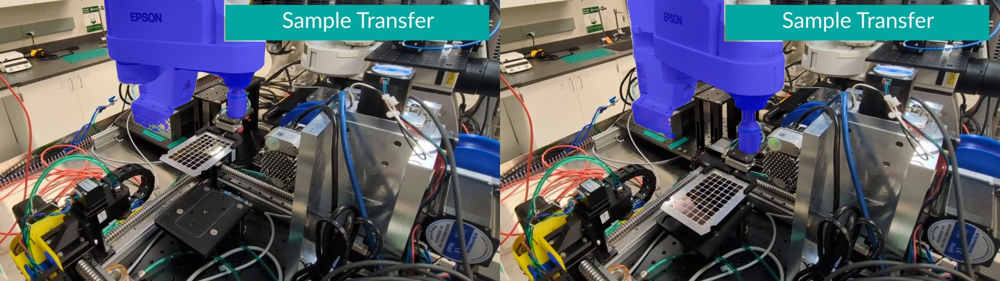
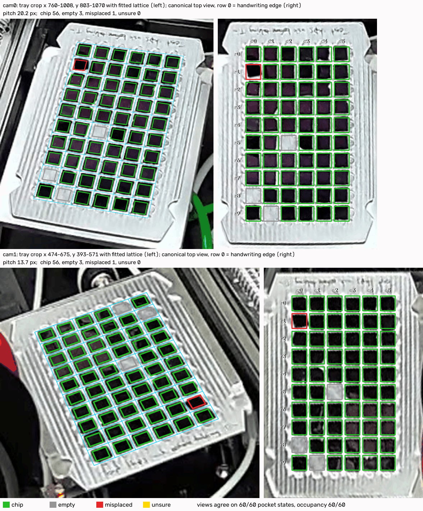
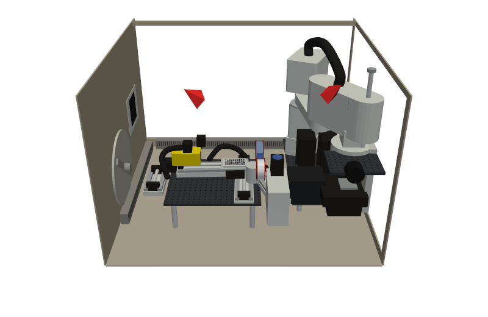
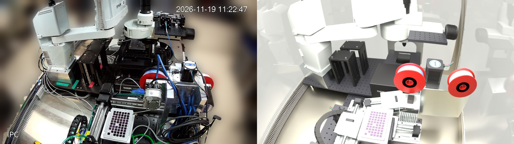

# Exfoliation Overhead cameras (Amcrest) → Pi 5 → YouTube

The two **Amcrest security cameras** in the Aurora glovebox, **Exfoliation
Overhead 1** (`192.168.3.150`) and **Exfoliation Overhead 2** (`192.168.3.151`),
stream to YouTube through the **Pi 5** (the ex-OT-2 overhead HQ camera, now
the "cataloging stage overhead" stream). The Pi 5 reaches the cameras through
an Ethernet switch on its `eth0`. This follows the 2026-11-06 analysis in issue
#23 ([comment](https://github.com/borysgroup/aurora-cloud-infra/issues/23#issuecomment-6697495676)).

## Status (2026-11-19)

- **Streaming, installed for good.** `amcrest-relay@0` and `@1` on the Pi 5
  copy each camera's H.264 (no re-encode) to its own **unlisted** YouTube
  broadcast, in a **private** playlist per camera. They start at boot, so each
  of the Pi's scheduled reboots (05:00, 13:00, 21:00) starts fresh broadcasts,
  as for the picam. See [Pi 5 setup](#pi-5-setup-2026-11-19).
- **`eth0` has a fixed address,** `192.168.3.199/24`, from
  `amcrest-eth0.service`: no gateway, never the default route, an in-memory
  NetworkManager profile. `ip_forward` stays 0.
- **Camera clocks fixed.** The Pi runs chrony and serves NTP to the camera
  subnet only. Both cameras sync to it every 10 minutes, on Mountain time with
  the US DST rule, so DST changes need nothing. See [Camera clocks](#camera-clocks).
- **No audio,** as intended. The cameras' microphones stay disabled; the relay
  sends a silent track because YouTube expects one.
- **Vision** on the stills: everything but the glovebox interior and any
  face blurred before publishing, with the Epson segmented on every frame; the
  chip tray read from both views; lens intrinsics; both cameras calibrated
  together; and a CAD reconstruction of the interior, part by part. See
  [Vision](#vision).
- **No pan/tilt/zoom.** See [Angle and image controls](#angle-and-image-controls).
- **2026-11-20: both cameras offline.** Neither `.150` nor `.151` has answered
  since the Pi's 13:00 MST reboot (no ARP reply; `eth0` up with `.199`). The
  lab took at least one down to fit other equipment. Both relays hit
  systemd's restart limit and are `failed` (open item 9). The picam is
  unaffected.
- **A segmentation model for the Epson,** for live blurring, trained here on
  mixed-reality images from Epson's own CAD. See
  [Epson segmentation model](#epson-segmentation-model-trained-2026-11-20).

## Stills (2026-11-19 18:22 UTC)

Grabbed within 2 s of each other with `pull_feed.py N still`. Before
publishing, [`vision/privacy_blur.py`](vision/privacy_blur.py) keeps sharp
only what is known to be the glovebox interior, segments the Epson on every
frame so it stays sharp wherever it is, and blurs everything else and any
faces (see [Privacy blur](#privacy-blur)). No one was in either frame.

| Exfoliation Overhead 1 (`192.168.3.150`) | Exfoliation Overhead 2 (`192.168.3.151`) |
|---|---|
|  |  |
| Wide view: the Epson SCARA, the microscope, the exfoliator and the chip tray | Close view: the XY gantry with the chip tray and the antechamber-end wall; the Epson's arm 2 passes just under the camera, out of focus at the lower right, and is blurred |

The earlier stills in `captures/` (00:23 and 16:38 UTC) are re-blurred the
same way.

## Camera settings (read 2026-11-19)

Read with [`read_camera_config.py`](read_camera_config.py) (admin login over
stdin, `getConfig`/`getCaps` only). Both cameras are configured identically:

| Stream | Enabled | Codec | Size | fps | GOP | Rate control | Bitrate |
|---|---|---|---|---|---|---|---|
| Main (`subtype=0`) | yes | H.264 Main | 1920x1080 | 20 | 40 (2 s) | CBR | 4096 kbit/s |
| Sub 1 (`subtype=1`) | **no** | H.264 Main | 704x480 | 20 | 40 | CBR | 512 kbit/s |
| Sub 2 (`subtype=2`) | **no** | H.264 Main | 704x480 | - | - | CBR | 1024 kbit/s |

Audio is disabled on every stream (`AudioEnable=false`). The sensor is 5 MP,
but the main stream is set to 1080p.

Measured over 12 s on the Pi 5 ([`pull_feed.py`](pull_feed.py) `N packets 12`):
19.97 fps, 4208 and 4270 kbit/s, keyframes exactly 2.0 s apart, no B-frames.

Other settings seen:

- **On-screen text:** channel title `IPC` (the default) bottom left, date and
  time top right. A title per camera would identify the feeds on YouTube.
- **Image:** `Flip=false`, `Mirror=false`, `Rotate90=0`, infrared off,
  day/night auto.
- **Sessions:** the cameras' active-user list showed only the read itself, so
  no web UI or SDK client (such as an NVR) was logged in. RTSP clients don't
  appear in that list (the relays' own sessions didn't), so it can't rule out
  another RTSP viewer.
### Camera clocks

**Found** (read 16:45 UTC): on both cameras `NTP.Enable=false` (server
`time.windows.com`, unreachable without an internet path), time zone
`NTP.TimeZone=26` (GMT-06:00, "CentralAmerica") and `Locales.DSTEnable=false`.
The burned-in clocks read 1 h 01 min 48 s (`.150`) and 1 h 01 min 41 s (`.151`)
ahead of Mountain Standard Time: an hour from the wrong zone, the rest drift.

**Changed** (16:47 UTC, [`camera_time.py`](camera_time.py) `ntp`, admin login
over stdin, one camera at a time, both read back):

| Setting | Before | After |
|---|---|---|
| `NTP.Enable` | `false` | `true` |
| `NTP.Address` | `time.windows.com` | `192.168.3.199` (the Pi 5's `eth0`) |
| `NTP.TimeZone` | `26` (GMT-06:00) | `27` (GMT-07:00) |
| `NTP.UpdatePeriod` | `10` | `10` (minutes) |
| `Locales.DSTEnable` | `false` | `true` |
| `Locales.DSTStart` / `DSTEnd` | 2nd Sunday of March 02:00 / 1st Sunday of November 02:00 | unchanged |

Straight after, both cameras showed the Pi's time to the second (09:47:32 MST
at 16:47:32 UTC), and chrony on the Pi listed both as clients.
`NTP.TimeZoneDesc` still reads `CentralAmerica`: the firmware didn't update
that label, and the time shown is GMT-07:00.

So the overlay shows local time: MST now, MDT from the second Sunday of March,
with the camera switching by itself, and NTP from the Pi removing drift every
10 minutes. The switch itself can only be seen on 2027-03-14. For UTC on the
overlay instead, set `NTP.TimeZone=0` and `Locales.DSTEnable=false`.

**The NTP server.** Debian's `chrony` package replaced systemd-timesyncd on the
Pi 5 (default Debian pool sources, stratum 3 at install).
[`pi5/aurora-cams.conf`](pi5/aurora-cams.conf), in `/etc/chrony/conf.d/`,
allows clients from `192.168.3.0/24` only. Until chrony has synchronised (after
a reboot without network, say), it answers as unsynchronised, so the cameras
keep their own time rather than taking a wrong one.

### Angle and image controls

The cameras can't be aimed remotely. Each reports:

- `ptz.cgi?action=getStatus` → `400 Bad Request`, and the PTZ protocol caps hold
  only `AutoFocus=false`.
- `devVideoInput.cgi?action=getCaps`: `ElectricFocus=false`, `Iris=false`,
  `SyncFocus=false` (fixed lens, no motorized zoom or focus), but `Flip=true`,
  `Mirror=true`, `Rotate90=true`.
- ONVIF lists no PTZ service (only `device`, `media`, `media2`, `imaging`,
  `analytics`, `events`).

So the view only changes by hand, by loosening the turret and re-aiming it.
Remotely, the image can be flipped, mirrored or rotated 90°, and exposure,
day/night and infrared can be changed. A "digital zoom" would mean cropping on
the Pi, which needs a re-encode instead of the copy relay.

## Relay to YouTube

### How it works

[`amcrest_relay.py`](amcrest_relay.py) runs on the Pi 5, one instance per
camera:

1. Probes the camera (about 3 s). If it doesn't answer, it exits without asking
   for a broadcast, so a camera that is down leaves no empty scheduled
   broadcasts behind.
2. Calls the picam Lambda (the one in the Pi 5's `my_secrets.py`) with `end`,
   then `create`, as `device.py` does. The Lambda creates the stream key and
   the broadcast and adds the broadcast to the workflow's playlist.
3. Runs `ffmpeg`: RTSP over TCP in, `-c:v copy` (no decode or encode), a silent
   AAC track added (`anullsrc`, 128 kbit/s, because YouTube expects audio), FLV
   out to YouTube's **RTMPS** ingest.
4. Restarts `ffmpeg` against the same broadcast if it exits or makes no
   progress for 60 s. The broadcast has auto-stop off, so it resumes. After 5
   quick failures in a row it exits and leaves the next step to systemd.
5. Ends and replaces its broadcast after 11 h, so none runs past YouTube's
   12 h archive limit even when the Pi's 8-hourly reboot is held off.
6. On `SIGTERM` (stop or reboot) it stops `ffmpeg` and calls `end`, so the
   broadcast closes cleanly and its archive is kept.

`--test-output FILE` writes a short local FLV instead (no Lambda calls), for
checking the camera side.

### Secrets

- **Viewer login:** read from `~/.config/aurora-security-cams/cams.env` on the
  Pi. `ffmpeg` gets the camera through an `ffconcat` file (mode 600, in a
  mode-700 runtime directory) holding the credentialed RTSP URL, so the login
  never appears on a command line or in the process list. ffmpeg 7.1 can't
  load `-i` from a file (`-/i` is rejected). The concat demuxer's `option`
  lines carry `rtsp_transport tcp` and the socket timeout through (checked:
  the relays' `ffmpeg` has no UDP sockets).
- **Lambda URL:** parsed (not imported) from the picam's `my_secrets.py`, or
  taken from `$LAMBDA_FUNCTION_URL`.
- **Logs:** every line `ffmpeg` prints is redacted (RTSP logins, stream keys,
  video IDs), and the relay never logs the stream key, video ID or broadcast
  URL, so the journal is safe to read out. (`device.py` itself does print its
  stream URL to the journal.)

### Playlist privacy

The Lambda adds each new broadcast to the first playlist whose title contains
the workflow name. Only if none exists does it create
`"<workflow> Livestreams Playlist"`, **with the broadcast's privacy**. So a new
workflow's first `create` decides the playlist's privacy for good. To get a
private playlist with unlisted broadcasts, as the picam devices have:

1. Run the relay once with `--privacy private` for about a minute: this creates
   the private playlist (and a short private broadcast).
2. From then on, run it with `--privacy unlisted` (the default, and what the
   units use).

A cleaner fix would be an optional `playlist_privacy_status` field in
`create_broadcast_and_bind_stream` in
[`borysgroup/streamingLambda`](https://github.com/borysgroup/streamingLambda/blob/main/chalicelib/ytb_api_utils.py)
(default `private`).

### Names

| Slot | Camera | `CAM_NAME` | `WORKFLOW_NAME` (and playlist) |
|---|---|---|---|
| `_0` | `192.168.3.150` | `amcrest-150` | `Exfoliation Overhead 1` |
| `_1` | `192.168.3.151` | `amcrest-151` | `Exfoliation Overhead 2` |

Broadcast titles read `Exfoliation Overhead 1 stream amcrest-150, <date> UTC
<time>`. The Lambda matches **substrings** for both `end` (which ends every
live broadcast whose title contains the workflow name) and the playlist lookup.
So a workflow name must not contain, or be contained in, another device's
name: `Exfoliation Overhead 1` and `... 2` don't overlap each other or
`Cataloging stage overhead`, but adding an `Exfoliation Overhead 10` later
would let camera 1's `end` end it. Renaming starts a new playlist (and needs the
private first run again). The cameras' on-screen title is still `IPC`.

### Why RTMPS, and what it costs

The Pi 5's `stream-watchdog.sh` restarts `device.service` when the RTMP
**port 1935** socket with the most bytes ACKed stops growing. A relay on port
1935 could hide a stalled picam stream, or, once it stalls itself, make the
watchdog restart a healthy picam stream. So the relay rewrites the Lambda's
`rtmp://a.rtmp.youtube.com/live2/<key>` to
`rtmps://a.rtmps.youtube.com:443/live2/<key>` (same key). During the test,
`ss` showed exactly one port-1935 socket (the picam's), and the watchdog
logged nothing.

The cost is upload. Each relay sends about **5.7 Mbit/s** for a 4.4 Mbit/s
camera feed, about 28 % more. That fits ffmpeg's RTMP client writing 128-byte
chunks, each of which becomes its own TLS record (about 29 bytes of overhead).
Plain RTMP should need about 4.6 Mbit/s per camera (an estimate, not
measured). To get that back, make the
watchdog look only at the picam's own socket (add
`cgroup /system.slice/device.service` to its `ss` filter), then run the relays
with `--no-rtmps`. That changes the picam's watchdog, so it was not done here.

### Measured on the Pi 5 (2026-11-19, both relays running)

| | Before | With both relays |
|---|---|---|
| `wlan0` upload | 0.6 Mbit/s | 12.5 Mbit/s (5.7 + 5.7 relays, 0.64 picam, plus TCP/IP) |
| `eth0` download | 0 | 8.8 Mbit/s |
| Load average | 0.08 | 0.08 to 0.3 |
| Relay CPU | | about 3 % of one core each (copy, plus AAC of silence) |
| SoC temperature | 51.8 °C | 52.7 °C |
| TCP retransmits on the YouTube sockets | | under 0.1 % |
| Picam on YouTube | health `ok`, `bitrateLow` | unchanged (`ok`, `bitrateLow`) |
| `device.service` | 0 restarts | 0 restarts |

Wi-Fi was 5.8 GHz at -34 dBm with an 86.6 Mbit/s link rate. Both relays held
stream health `good`. The only issue YouTube raised was `audioBitrateLow` (the
silent track), which the picams get too. In total the relays add about
11 Mbit/s of sustained upload, roughly 5 GB per hour.

### What is on YouTube

On *Aurora PCL Hardware Streams*, all playlists **private**:

| Playlist | Holds |
|---|---|
| `Exfoliation Overhead 1 Livestreams Playlist`, `... 2 ...` | a 1-minute private broadcast (16:48 UTC on 2026-11-19, which created the playlist), then the unlisted broadcasts from 16:50 UTC on; each reboot of the Pi adds one per camera |
| `Aurora security cam 150 Livestreams Playlist`, `... 151 ...` | the first test (2026-11-19 00:22 to 04:00 UTC): a 1-minute private broadcast, a 3 to 4 minute unlisted one and an unlisted one of about 3.5 h |

Checked with the read-only token at 16:51 UTC: both relays live, `unlisted`,
stream health `good`, no configuration issues; the picam on the same Pi
unchanged (`ok`, `bitrateLow`). The upload token can't delete or edit videos,
and nothing was deleted.

## Pi 5 setup (2026-11-19)

| What | Where | Notes |
|---|---|---|
| `amcrest-eth0.service` | `/etc/systemd/system/`, enabled | creates the in-memory NetworkManager profile `cam-link` at boot: `192.168.3.199/24`, no gateway, `ipv4.never-default`, no DNS, no IPv6, duplicate-address detection, autoconnect priority 50 so it comes back after a link drop (the DHCP profile `netplan-eth0` has 0) |
| `amcrest-relay@0`, `@1` | `/etc/systemd/system/amcrest-relay@.service`, enabled | `~/aurora-security-cams/amcrest_relay.py` as `vcl`, names from `~/.config/aurora-security-cams/relay-N.env` (mode 600, no secrets), `Nice=10`, at most 3 starts an hour |
| chrony | Debian package (replaced systemd-timesyncd) | `/etc/chrony/conf.d/aurora-cams.conf`: serves `192.168.3.0/24` only |

Unchanged: `device.service` (0 restarts after the install), the watchdog and
reboot timers, `ip_forward=0`, the default route on `wlan0`, `cams.env`.

**Why `.199`:** the segment has no DHCP server, `.199` drew no reply to a
duplicate-address probe (`arping -D`) on 2026-11-19, and every session since
2026-11-11 has used it without a conflict. If someone keeps an address plan for
this network, `.199` should go in it. The `.1` gateway that never answers
doesn't matter to the relay; while nothing answers there, the cameras have no
route to the internet. If a router ever appears at `.1`, they would have one.

Install, as done here (on the Pi 5, from a checkout of this directory):

```bash
mkdir -p ~/aurora-security-cams && cp amcrest_relay.py ~/aurora-security-cams/
install -m 600 systemd/relay-0.env systemd/relay-1.env ~/.config/aurora-security-cams/
sudo apt-get install chrony    # replaces systemd-timesyncd
sudo install -m 644 pi5/aurora-cams.conf /etc/chrony/conf.d/ && sudo systemctl restart chrony
sudo cp systemd/amcrest-eth0.service systemd/amcrest-relay@.service /etc/systemd/system/
sudo systemctl daemon-reload
sudo systemctl enable --now amcrest-eth0.service
# new workflow names only: one private run per camera first (see Playlist privacy)
sudo systemctl enable --now amcrest-relay@0.service amcrest-relay@1.service
```

Stop or undo:

```bash
sudo systemctl disable --now amcrest-relay@0 amcrest-relay@1   # ends both broadcasts
sudo systemctl disable --now amcrest-eth0                      # eth0 back to no address
sudo apt-get install systemd-timesyncd                          # replaces chrony; the cameras lose their time source
```

## Vision

Scripts in [`vision/`](vision/) work on stills from `pull_feed.py`; results
are in [`vision/out/`](vision/out/). The raw stills stay off the repo, because
they show the lab around the glovebox. Below, camera 1 and camera 2 are
Exfoliation Overhead 1 (`.150`) and 2 (`.151`); the scripts call them `cam0`
and `cam1`, after their `cams.env` slots.

### Privacy blur

[`vision/privacy_blur.py`](vision/privacy_blur.py) `--cam N IN.jpg OUT.jpg`
keeps a pixel sharp only if it is known to show the glovebox interior. The
walls on both long sides are clear, so most of each frame's edge is the room,
seen through them, and it is blurred:

1. **Static interior:** [`vision/masks/inside_camN.png`](vision/masks), built
   once per view by [`vision/build_inside_mask.py`](vision/build_inside_mask.py)
   from [`vision/inside_masks.json`](vision/inside_masks.json). That file
   holds hand-drawn polygons for the deck, the walls and the bulk of the
   equipment, plus point prompts for SAM 2.1 (`sam2.1_b`, through
   `ultralytics`), which outlines each piece of equipment that stands in front
   of a window to the pixel. The robot's moving parts are not in this mask.
2. **The Epson, wherever it is:** SAM 2.1 runs again on every frame. Its
   prompts sit only on parts of the robot that never move: the base, the riser
   and the controller box, which Epson's T-B drawing shows fixed to the base.
   Negative prompts sit on the room next to it. SAM returns the robot in its
   current pose, arm included.
   - A prompt whose patch no longer matches the reference is dropped, for
     example when the arm passes in front of it.
   - Only the part inside the camera's `robot_zone` is kept.
   - Only pixels that the reference frame also had as robot, or that have
     changed since, are kept. A mask that spills onto the unchanged room
     behind the robot is cut back.
   - If the segmentation misses part of the arm, that part is blurred, never
     the room. On the reference frame, the upper part of arm 2's housing is
     blurred for this reason.
   - Overhead 2 sees no fixed part of the Epson, only arm 2, which passes
     just under the camera: its housing at the right edge and a black unit on
     it, out of focus at the lower right. Both are simply blurred.
   - About 3 s per frame on 4 CPU cores.
   - `--robot yolo` runs the trained model from
     [Epson segmentation model](#epson-segmentation-model-trained-2026-11-20)
     on the robot zone instead, with the same zone and reference checks.
3. **Change guard:** interior pixels that differ from
   [`vision/masks/reference_camN.jpg`](vision/masks) (the blurred frame the
   mask was built on), in a blob that touches the blurred region, are blurred
   too. This covers equipment moved away from a window, which would otherwise
   expose the room through the static mask. Changes in the middle of the deck,
   such as the stage moving, are not touched.
4. **Faces:** deface's CenterFace model (`deface` 1.5.0 with onnxruntime) on
   the whole unmodified frame, at deface's default threshold of 0.2, and an
   elliptical blur over each detection.
5. **Burned-in date and time** are kept: only small near-white strokes with a
   dark outline are copied back, so no patch of a bright background behind
   the clock comes through.

On the 18:22 UTC frames this keeps 61.3 % of Overhead 1 and 62.5 % of
Overhead 2 sharp. The robot's segmentation has only been seen in its parked
pose; the arm did not move during this work.

Re-run `build_inside_mask.py --cam N FRAME.jpg` after re-aiming a camera or
moving equipment that stands in front of a window, and check the reference it
writes.

This covers the published stills, not the live streams. The cameras' own
privacy masks are solid boxes and would also apply to any other viewer, such
as a recorder.

### Live blur on the Pi 5 (measured 2026-11-19)

The stills pipeline can't run live: SAM 2.1 takes about 3 s per frame on the
runner's four x86 cores, and the Pi 5 has no hardware video encoder. What the
Pi can do was measured on the Pi itself with
[`vision/live_bench.py`](vision/live_bench.py), at `nice 19` on two of its four
cores while the picam and the Overhead 2 relay ran. The picam uses about
0.5 core. Results are in
[`vision/out/live_bench_pi5.json`](vision/out/live_bench_pi5.json).

**Decode, blur and re-encode** per camera, on a 20 s copy of Overhead 2's main
stream (1080p, 20 fps). One core at 20 fps is 50 ms per frame.

| Output | CPU per frame | Cores at 20 fps |
|---|---|---|
| Decode only | 9.4 ms | 0.19 |
| 1080p, x264 superfast, no blur | 39.8 ms | 0.80 |
| 1080p, static-mask blur, x264 superfast | 66.0 ms | 1.32 |
| 720p, x264 superfast, no blur | 27.0 ms | 0.54 |
| 720p, static-mask blur, x264 superfast | 46.7 ms | 0.93 |
| 720p, static-mask blur, x264 ultrafast | 41.7 ms | 0.83 |
| 720p, static-mask blur, x264 veryfast | 52.5 ms | 1.05 |

The blur is done in `ffmpeg`: the frame at 1/8 scale, Gaussian-blurred and
scaled back, with the sharp frame laid over it through the mask. In this test
`ffmpeg` decoded the mask PNG again for every frame. On a single thread the
720p superfast run took 43.5 ms per frame, so one core keeps up with one camera
(23 fps).

**Segmentation models,** onnxruntime 1.32 on the Pi's CPU, median of 15 runs:

| Model | Input | 1 thread | 2 threads |
|---|---|---|---|
| YOLO11n-seg | 640 x 640 | 518 ms | 293 ms |
| YOLO11n-seg | 320 x 320 | 113 ms | 63 ms |
| YOLO11n-seg | 256 x 256 | 73 ms | 40 ms |
| EdgeSAM (point prompts, like SAM) | encoder 1024 x 1024, then decoder | 2.54 s + 0.28 s | 1.58 s + 0.19 s |

YOLO11n-seg was timed with Ultralytics' COCO weights. A model trained only on
the Epson has the same network and costs the same.

**What fits.** Both cameras at 1080p would need 2.6 cores on top of the
picam, which leaves too little. At 720p:

| | Cores |
|---|---|
| Picam, as now | 0.5 |
| Overhead 2: static mask, 720p | 0.9 |
| Overhead 1: static mask, 720p | 0.9 |
| Overhead 1: YOLO11n-seg on the robot zone, 5 times a second, one thread | 0.7 |
| **Total, of 4** | **3.0** |

How the Epson step would work live:

- The model runs on Overhead 1's `robot_zone` (1350 x 700 px), fed at
  448 x 232 in a 448 x 256 input: 123 ms on one thread, measured with the
  trained model (see
  [Epson segmentation model](#epson-segmentation-model-trained-2026-11-20)),
  plus about 20 ms for pre- and post-processing.
- Between runs, each frame reuses the last mask, cut back to the pixels that
  have not changed since the frame it was computed on. A spot the arm leaves
  changes from robot to room and is blurred at once. So a lagging mask can
  blur part of the arm but never shows the room. During a fast move, the arm
  is blurred where it crosses a window until it slows down.
- Overhead 2 needs no robot step: its view of the arm is blurred anyway.
- Faces: the static mask, the robot step and the change guard already keep
  the room blurred. A face detector at 1 to 2 fps could act as a tripwire that
  blurs the whole frame for a few seconds on a hit.

What it needs first:

- **Training data.** COCO has no class for a robot arm, so the model has to be
  trained on this camera's view of the Epson. Done without footage of the arm
  moving, from Epson's CAD: see
  [Epson segmentation model](#epson-segmentation-model-trained-2026-11-20).
  A few minutes of the arm moving, recorded on the Pi with
  `pull_feed.py 0 record SECONDS OUT.mp4`, are still the best test.
- **720p output** for both cameras.

Alternatives:

- **Joint angles instead of a model.** If the lab's software can publish the
  Epson's joint angles, the calibrated CAD model (`reconstruction/scene.py`)
  can draw the arm's mask for each frame directly. The current fit (IoU 0.64
  in Overhead 1) is too loose for that unless the model is refined or the mask
  shrunk.
- **Hardware.** A Raspberry Pi AI HAT+ (Hailo) on the Pi 5's free PCIe
  connector would take the model off the CPU, but the encoders are the larger
  cost. A small x86 machine with Intel Quick Sync on the camera switch could
  encode both feeds in hardware at 1080p.
- **EdgeSAM** takes SAM 2.1's prompts and needs no training. At about 1.8 s
  per frame on two cores, it could update the mask only every few seconds.

### Epson segmentation model (trained 2026-11-20)

[`vision/robotseg/`](vision/robotseg/) trains the YOLO11n-seg for the live
robot step without any footage of the arm moving. The training images are
mixed reality: real frames of each camera with Epson's own CAD robot drawn
into them at random joint angles. Everything ran on the runner's four CPU
cores, no GPU.

**Epson's CAD.** Epson publishes the T6-B602S as a STEP assembly (base, arm 1,
arm 2, shaft, user duct) on its support page.
[`reconstruction/epson_cad.py`](reconstruction/epson_cad.py) downloads it,
meshes each link with gmsh and articulates it at J1, J2, Z and U, within the
manual's limits (J1 ±132°, J2 ±150°, Z 200 mm). The STEP file and the meshes
are not redistributed here.

**Where the robot is.** [`fit_pose.py`](vision/robotseg/fit_pose.py) fits the
base (J1 position, height and yaw) and the parked joint angles to the SAM 2.1
silhouette in Overhead 1. Silhouette IoU in the robot zone is 0.78, against
0.57 for the hand-built model in `scene.py`. Much of the remaining gap is the
SAM mask's: it misses the top of arm 2's housing and includes the riser block
and the cables above the controller. Result:
[`vision/out/epson_pose.json`](vision/out/epson_pose.json).

**Training images** ([`synth.py`](vision/robotseg/synth.py), drawn by
[`epson_render.py`](vision/robotseg/epson_render.py)):

- **Plate:** one of the stored frames of either camera. The parked robot (its
  CAD silhouette and SAM mask, dilated) is cut out and filled with a room
  from a robot-free shot of the AURORA video: labs, people, a server room.
- **Outside the glovebox:** often replaced by an unblurred room crop. The
  stored stills are blurred there and the live feed is not. This also puts
  people, benches and screens next to the arm as hard negatives.
- **Robot:** Epson's CAD at random J1, J2, Z and U over the full range (a
  third near the parked pose), drawn through the camera's calibrated pose and
  lens distortion. The renderer is a painter's algorithm in OpenCV: about
  0.3 s per image, no OpenGL. The label is the rendered mask, so it fits the
  drawn robot exactly.
- **Also randomised:** the base position (σ 8 mm), height (σ 5 mm) and yaw
  (σ 1°), the camera's rotation (σ 0.4°), a stand-in end effector, blur,
  noise, JPEG quality, and occluders cut from the plate.
- **Crop:** Overhead 1 images are its robot zone (1350 x 700 px), as the live
  step would run it. Overhead 2 images are the whole frame.

Two models were trained:

| | v1 | v2 (committed) |
|---|---|---|
| Images (train + validation) | 1,600 + 160 | 2,000 + 200 |
| Robot's look | flat-shaded, random grey level, tint and light | 55 % textured: each face takes its colour from Overhead 1's 18:22 frame, where the camera saw it at the parked pose, and keeps it at any other pose |
| Cameras | the two calibrated ones | also 40 % random pinhole cameras, 0.35 to 1.5 m from the robot, from any side, up to 65° above it, over a room crop or a plate |
| Training | from COCO weights, 10 epochs, 29 min | from v1, 8 epochs, 24 min |
| Validation mask mAP50-95 (synthetic) | 0.90 (epoch 10, its own set) | 0.86 (epoch 7, its own set, with random cameras) |

**The video.** The [AURORA video](https://www.youtube.com/watch?v=moBCWzP9Izw)
(60 s) has two shots with a T6. It was downloaded through the Pi 5, because
YouTube blocks the runner's IP, at 800 KB/s, and is not redistributed.
[`label_video.py`](vision/robotseg/label_video.py) labels both shots with SAM
2.1's video predictor. The "retrieval" shot shows another T6, and SAM left
part of that robot out, so it is not used. The "transfer" shot shows this
glovebox's T6 moving under a handheld camera. It is held out as a test.

**Results on real frames held out from training**
([`evaluate.py`](vision/robotseg/evaluate.py), with the ONNX model run by
[`yolo_onnx.py`](vision/robotseg/yolo_onnx.py) exactly as on the Pi;
[`vision/out/robotseg_eval.json`](vision/out/robotseg_eval.json) for v2):

| Test frames | v1: IoU / precision / recall | v2: IoU / precision / recall |
|---|---|---|
| Overhead 1, the unblurred 00:23 still, arm parked | 0.80 / 0.93 / 0.85 | 0.88 / 0.90 / 0.97 |
| Overhead 1, the three published (blurred) stills | 0.76 / 0.87 / 0.86 | 0.87 / 0.91 / 0.96 |
| AURORA video, transfer shot, 30 frames | 0.00 (nothing detected) | 0.03 / 0.07 / 0.03 |

- **Ground truth** is SAM 2.1 in both cases: point prompts on the stills, the
  video predictor on the shot. It has its own errors. On the blurred stills
  the top of arm 2's housing is patchy, so some of the model's "false
  positives" there are robot.
- **Independence.** v1 never saw a real pixel of this robot. v2's textures
  come from Overhead 1's 18:22 frame, so its Overhead 1 scores are not
  independent: same parked robot, same place (18:22 itself scores IoU 0.91).
  The video is independent for both: another camera, other light, the arm
  moving.
- **The video is a failure for both.** Neither model finds the robot in the
  handheld views, where it is close, large and cut off by the frame edge.
  Cropped nearer the training scale, a frame scores 0.5 to 0.6, so it is
  mostly viewpoint and scale, but v2's random cameras did not cover it.
  Treat the model as specific to the calibrated views.
- **Precision is what matters for privacy:** a false positive keeps a patch
  sharp. In the pipeline the robot mask is also cut to the robot zone, and to
  pixels that were robot in the reference or have changed since, as with SAM.

| v2 on two published stills | v2 on two held-out video frames |
|---|---|
|  |  |

Green: model and ground truth agree. Red: model only. Blue: ground truth only.

**On the Pi 5,** measured with [`bench_pi.py`](vision/robotseg/bench_pi.py) on
2026-11-20 (onnxruntime 1.32, 448 x 256 input, median of 20 runs at `nice 19`
while the picam streamed):

| | 1 thread | 2 threads |
|---|---|---|
| Forward pass, median | 123 ms | 68 ms |
| Forward pass, 90th percentile | 147 ms | 95 ms |

That matches the stock model's 113 ms at 320 x 320, scaled for the larger
input. Letterboxing, NMS and the masks add 2.3 ms on the runner, where the
forward pass takes 12.5 ms. The Pi is about 10 times slower here, so that is
roughly 20 ms more on the Pi (an estimate: the Pi has no OpenCV, which
`yolo_onnx.py` needs). Five runs a second on one thread is then about 0.7 of
a core, the figure now in the "What fits" table above. The picam had 0
restarts before and after, and nothing was left on the Pi.

**Use:** `python vision/privacy_blur.py --cam 0 --robot yolo IN.jpg OUT.jpg`
runs the model ([`vision/robotseg/models/epson_t6_seg.onnx`](vision/robotseg/models/epson_t6_seg.onnx),
11.6 MB) on the robot zone instead of SAM. SAM stays the default for stills.

**To rebuild.** The STEP and the video are fetched, not stored here. The
unblurred 00:23 stills are in this branch's history at fa312e2; `synth.py`
tells the cameras apart by `cam0`/`cam1` in the file name.

```
python reconstruction/epson_cad.py                 # Epson's STEP -> meshes in ~/.cache
yt-dlp -f 137 -o VIDEO.mp4 https://www.youtube.com/watch?v=moBCWzP9Izw   # from a residential IP
cd vision/robotseg
python fit_pose.py                                  # -> ../out/epson_pose.json
python label_video.py VIDEO.mp4 VLABELS             # SAM 2.1 labels for both T6 shots
S="python synth.py --raw raw0023_cam0.jpg raw0023_cam1.jpg --video VIDEO.mp4"
$S --out V1 -n 1600 --seed 1 && $S --out V1VAL -n 160 --seed 2
python train.py --syn-train V1 --syn-val V1VAL --work W1 --epochs 10
$S --out V2 -n 2000 --seed 11 --textured 0.55 --virtual 0.4
$S --out V2VAL -n 200 --seed 12 --textured 0.55 --virtual 0.4
python train.py --syn-train V2 --syn-val V2VAL --work W2 --epochs 8 --init W1/train/weights/best.pt
python evaluate.py --stills raw0023_cam0.jpg --video-labels VLABELS
```

**Limits:**

- **No frame of Overhead 1 with the arm away from its parked pose exists
  yet.** The first live footage of the arm moving is the real test.
  `pull_feed.py 0 record` can capture it. `evaluate.py`'s SAM prompts assume
  the parked pose, so those frames need their own.
- **A camera that comes back in another place** needs
  `calibrate_two_view.py`, the inside masks and `fit_pose.py` redone, then new
  training images and a retrain: about 30 min on four cores.
- **The end effector** is a stand-in box; the real tool is not modelled.

### Chip tray

[`vision/chip_tray.py`](vision/chip_tray.py) `CAM0.jpg CAM1.jpg --out DIR`
finds the tray in each view, fits the pocket lattice with a homography,
rectifies it, and classifies every pocket. It then compares the two views in
one tray frame: row 0 is the handwritten edge, and columns keep the same
handedness seen from above. That mapping comes from tray features only, not
from which pockets are full, so the occupancy comparison is an independent
check.



On the 16:38 UTC stills:

- The tray is a **6 x 10 grid** (60 pockets). The chamber model's "8 x 8" was
  a different tray.
- **Both views agree on all 60 pockets:** 56 chips, 3 empty, 1 misplaced.
- **Empty:** (column 2, row 5), (0, 8) and (1, 9).
- **Misplaced:** the chip at (0, 1) is rotated about 11° in its pocket (10.9°
  from camera 1, 12.5° from camera 2, the same way round). It is centred and
  of normal size. Most chips sit within 4°; the threshold is 10°, so this flag
  depends on it.
- As a separate check, of the 4 rotations and flips that fit a 6 x 10 grid,
  only the feature-based one matches all 60 pockets (the others match 54).
- Fit residuals: 0.5 px median (pitch 20 px) on camera 1, 0.2 px (pitch 14 px)
  on camera 2. Camera 2 sees the tray at a low angle, so it can't resolve
  rotations under about 5° or offsets under about 0.1 pitch.

Per-pocket results, angles and offsets are in
[`vision/out/chip_tray.json`](vision/out/chip_tray.json). The tray moves with
the stage, so the script searches a region of interest per camera (an option)
rather than fixed pixels; an edge row or column with no chips at all would be
missed.

### Lens intrinsics

Both cameras are the same model, so they are estimated together and checked
against each other. All values are for the 1920x1080 main stream, with the
principal point taken at the frame centre (not estimated).
[`vision/intrinsics.py`](vision/intrinsics.py) writes
[`vision/out/intrinsics.json`](vision/out/intrinsics.json).

**Published** (Amcrest spec sheet, which matches Dahua's IPC-HDW2541T-S (S2)):
1/2.7" CMOS, 2.8 mm F1.6 M12 lens, FOV H 111° / V 58° / D 132°, largest main
stream 2960x1668. The sensor and its pixel pitch are not published.

**Distortion:** strong barrel. The two-parameter division model
`p_u - c = (p_d - c) / (1 + l1 r² + l2 r⁴)` (r in units of 1000 px) is fitted
to 7 long straight edges ([`vision/plumbline.py`](vision/plumbline.py),
[`vision/plumb_lines.json`](vision/plumb_lines.json)): l1 = -0.289,
l2 = -0.090, with 0.48 px residual. Per camera it is (-0.298, -0.085) and
(-0.280, -0.109), so the two lenses agree. OpenCV's 8-coefficient rational
model reproduces it to 0.004 px (in `intrinsics.json`); the 5-coefficient form
is off by up to 16 px in the corners.

**Focal length (px):**

| Source | Camera 1 | Camera 2 |
|---|---|---|
| Published 2.8 mm, assuming a 2.0 µm pitch and the whole 2960-px width scaled to 1920 | 908 | 908 |
| Published FOV H / V / D, with the measured distortion | 1004 / 1073 / 949 | same |
| Chip tray as a planar target ([`vision/tray_focal.py`](vision/tray_focal.py)) | 1062 (1015 to 1111) | 1089 (998 to 1199) |
| Registration with f free | 1474 ± 328 | 1170 ± 1054 |
| **Adopted** | **1070 ± 45** | **1070 ± 45** |

The chip-tray value uses the orthogonality constraint on the tray's
homography after undistortion, which holds whatever the pocket pitch. Without
the distortion correction the same method gives inconsistent numbers (1311 and
1679, and worse for the other constraint), which also supports the distortion
fit. With f = 1070 px, the pose fits below have lower residuals than with 950
(6.5 against 7.6 px, and 0.8 against 1.4 px), and the implied FOV is
H 107.6° / V 58.1° / D 126.7°. The vertical matches the published 58°.
1070 px is 13 to 18 % above the whole-sensor value, which fits a 1080p stream
scaled from a central window of about 2560x1440 rather than from the whole
2960x1668 area. No published source confirms that.

### Camera poses

[`vision/calibrate_two_view.py`](vision/calibrate_two_view.py) fits both
cameras together, in the frame of the measured chamber model
(`design/aurora-chamber` on branch `claude/issue-23-20261109-2222`; x along
the box from the antechamber-end wall, y from the open side, z up from the
deck). Results are in [`vision/out/cameras.json`](vision/out/cameras.json).

- **What ties the views together** is the chip tray. Its 6 x 10 lattice is
  fitted in both frames, and the pocket correspondence between the views is
  known from tray features alone. That gives 60 shared points on a plane, with
  0.4 px (Overhead 1) and 0.18 px (Overhead 2) RMS residuals.
- **What places and scales the pair** are the chamber model's landmarks from
  [`vision/landmarks.json`](vision/landmarks.json): the microscope objective,
  the Epson's J1, the supply spool, the antechamber door hub and three deck
  ducts. They are weighted by the model's stated uncertainties.
- **Unknowns:** a shared focal length (fitted 1073 ± 39 px, against a prior of
  1070 ± 45), each camera's pose, and the tray's centre, yaw and pocket pitch.
  The tray is assumed level.

| | Camera centre (mm) | Looking |
|---|---|---|
| Overhead 1 (`.150`) | (348, 294, 700) | along the box, 16° towards the far window, 40° down |
| Overhead 2 (`.151`) | (1015, 338, 702) | back towards the antechamber wall, 36° towards the far window, 46° down |

Both cameras come out about 90 mm below the 790 mm ceiling, which fits a turret
mount. The chamber model's own landmarks do not agree with each other at this
level: once the two cameras are tied together by the tray, they miss by 9 to
38 px (worst: the Epson J1, 38 px). The model's numbers come from the
walkthrough video and are good to a few centimetres.

**Independent checks:**

- **The two tape reels, matched by eye in the two frames,** triangulate with
  gaps of 2 and 9 mm between the two rays.
- **The gantry's X-axis ball screw**, back-projected separately from each view,
  lands on the same line: y = 497 to 520 mm from Overhead 1, and 501 to 518 mm
  from Overhead 2. The model's axis runs along it.
- **The antechamber door** back-projected onto the wall plane has a
  180-190 mm radius. Its 15-inch antechamber datasheet value is 190 mm.
- **Breadboard holes:** a breadboard lying on the deck in Overhead 2 has its
  hole rows 25 mm apart at a top height of 30 to 37 mm. That is a metric
  breadboard (M6 on 25 mm) of usual thickness on the deck.
- **The QR sign's bottom edge** back-projects to 242 mm. The model calls the
  sign US Letter landscape (279 mm), so either it is a smaller sheet or the
  annotated corners are not its corners.

The tray pocket pitch comes out at 9.5 ± 1.1 mm (a 57 x 95 mm pocket field). A ruler
reading of the tray would pin the scale at about 1 %.

### CAD reconstruction

[`reconstruction/`](reconstruction/) models the glovebox interior as
individual parts in the same frame. Each part takes its size from a
datasheet or standard size where one exists, its position from the two
calibrated cameras, and its colour from the frames.
[`reconstruction/scene.py`](reconstruction/scene.py) holds every number;
[`reconstruction/out/parts.json`](reconstruction/out/parts.json) lists each
part with its bounds, colour and source.




| Overhead 1: published frame, and the model seen from the camera | Overhead 2 |
|---|---|
|  |  |

The model blended over each frame, with its edges in yellow:
[Overhead 1](reconstruction/out/overlay_cam0.jpg),
[Overhead 2](reconstruction/out/overlay_cam1.jpg). The renders apply the
cameras' measured lens distortion
([`reconstruction/render.py`](reconstruction/render.py)), so they compare
pixel for pixel with the photos.

**How each part is placed:**

- **Two views:** the chip tray (its lattice in both views, with every chip
  drawn in its pocket from `chip_tray.json`: 3 empty, 1 rotated) and the two
  tape reels (ray intersections).
- **Silhouette fit, two views:** the Epson T6-B602S. Its shape is from
  Epson's dimensioned T-B drawing (T-B manual Rev.13, pp. 43, 45, 52 and 162):
  - base flange and sloped column
  - controller box (226 x 130 x 193 mm, underside at 272 mm), fixed to the
    base on a rear column, with its top-rear chamfer
  - arm 1, 103 mm wide, from 60 mm behind J1 to 51 mm past J2
  - arm 2, 135.5 mm wide, its top falling towards the tip
  - the ø20 J3 shaft (410 mm long, 200 mm stroke)
  - the 32 mm corrugated duct between fittings over J1 and J2, flattened to
    stay under the ceiling

  J1's position, the base's facing and height, the riser height and both arm
  angles are fitted to the robot's SAM 2.1 masks in both frames
  ([`reconstruction/silhouette.py`](reconstruction/silhouette.py)), within
  J1 ±132° and J2 ±150°. Overlap: IoU 0.64 in Overhead 1 and 0.82 in
  Overhead 2. The fit puts the base's underside at 161 mm (the chamber model
  reads 150 to 180) and parks J3 63 mm from the microscope objective.
  - **The black object in Overhead 2:** this fit identifies the out-of-focus
    black object at its lower right. The model alone matches Overhead 2's
    white housing plus that object at IoU 0.77, so the object rides on
    arm 2. It is modelled as a black unit on arm 2; its make is not known.
- **Datasheet modules:**
  - the microscope is Olympus/Evident BX3 modules on a custom plate: a
    BX3-URA illuminator (drum 180 mm, body 402.5 mm long with the lamp port),
    a U-DP dual port (88 x 151 x 57 mm) and a U-TLU tube (ø60 x 57.6 mm)
  - a 20x objective (green ring)
  - the stage is probably an ASI OE-1250 (228.6 x 215.9 x 45.1 mm)
  - the large black THORLABS box has no connectors, so it is drawn as a
    breadboard platform rather than a controller
- **One view, onto a known plane:** the breadboards (edges back-projected at
  their heights), the gantry's posts, plate, screws and motors (Overhead 2),
  the exfoliator housing, stage and motors, the microscope's elevated
  breadboard, the Thorlabs platform and the two black docking fixtures
  (Overhead 1), and the tape measure on the deck.
- **Standard sizes:** M6 holes on a 25 mm grid (12.5 mm from the edge) on
  12.7 mm Thorlabs breadboards; NEMA 23 (57.2 mm) and NEMA 17 (42.3 mm)
  steppers; 16 mm ball screws; Panduit Type G 1 x 2 in slotted duct
  (32 x 54 mm).
- **The shell** is the chamber model's: 1200 x 1120 x 790 mm, sloped long
  windows. The far end is drawn as a window frame, because the room shows
  through it in Overhead 1.

**Accuracy:**

- **Parts placed from both views** reproject closely in both frames. The tray
  is within 0.4 px, and the two reels within 2 and 9 px.
- **The Epson** overlaps its masks at the IoU above (0.64 and 0.82).
- **Parts placed from one view** sit right in that view, but their depth along
  the ray rests on an assumed height. In the other view they can be off by 20
  to 50 mm.
- **Hidden geometry is inferred:** the breadboards' extents behind equipment,
  the far end, and the backs of parts.
- **Not modelled:** cables, tubing and wiring.

**Files:** `out/glovebox.glb` (all 124 parts, coloured, one node per part; opens
in any glTF viewer), `out/stl/<group>.stl` (one per group: glovebox, ducts,
breadboards, epson, gantry, exfoliator, microscope, deck), the renders above,
an orbit (`out/turntable.gif`) and `out/parts.json`. Rebuild with
`xvfb-run -a python reconstruction/build_reconstruction.py` (numpy, opencv,
trimesh, pyvista, scipy).

## Earlier findings

### The camera segment (2026-11-11)

The switch is **not** an isolated two-camera island. It is a real
`192.168.3.0/24` network with about 9 hosts:

| Host | Vendor (OUI) | What it is |
|---|---|---|
| `192.168.3.150` | Amcrest | Security camera, slot `_0` |
| `192.168.3.151` | Amcrest | Security camera, slot `_1` |
| about 7 others | Dell / Lenovo-class / TI / others | PCs / NVR / lab devices (not probed) |
| `192.168.3.1` | none | Gateway the cameras ARP for, but **nothing answered**: no working router on this segment |

With no live gateway, the cameras have no path to the internet, so their
Dahua-based firmware can't be reached from outside and can't phone home. The
relay keeps it that way (no NAT, `ip_forward=0` on the Pi).

`eth0` is up at 1 Gb/s full duplex. Its own NetworkManager/netplan profile is
DHCP, and there is no DHCP server on the segment, so until 2026-11-19 it had
**no IP** by default and each session gave it a temporary in-memory address.
Since 2026-11-19, `amcrest-eth0.service` gives it `192.168.3.199/24` at boot
(see [Pi 5 setup](#pi-5-setup-2026-11-19)).

### The two cameras

- **Model:** Amcrest **IP5M-T1179EW-AI-V3** (5 MP turret, Dahua OEM),
  firmware `2.880.00AC003.0.R`, build 2025-03-19.
- **Open TCP ports:** `80` (web UI and CGI), `554` (RTSP, Digest auth),
  `37777` (Dahua SDK).
- **ONVIF:** Profile S on `/onvif/device_service`.
- **Latency:** about 0.3 ms round trip from the Pi 5.
- **RTSP URL:**
  `rtsp://<user>:<pass>@192.168.3.15x:554/cam/realmonitor?channel=1&subtype=0`
  (main stream). Never put a real one on a command line or in a log.

### Viewer accounts (2026-11-18)

Using the admin login, a non-admin `relay` account was created on each camera
for the YouTube relay.

- **What was changed on the cameras:** one new user per camera, `relay`, group
  `user`, `Sharable=true` (concurrent sessions allowed), memo `youtube-relay`,
  created with `userManager.cgi?action=addUser`. The request asked for
  `Monitor_01` (live view) only, but the firmware applied the group's full
  rights, so the account holds `Monitor_01` + `Replay_01` (live view and
  playback of recordings). It has no configuration, user-management or network
  rights: the user-management API answers it with `403`. The `admin` account is
  untouched.
- **Where the credentials live:** repo variables `AMCREST_CAM_USERNAME_<n>` and
  secrets `AMCREST_CAM_PASSWORD_<n>` (`_0` = `.150`, `_1` = `.151`), and on the
  Pi 5 in `~/.config/aurora-security-cams/cams.env` (directory `700`, file `600`,
  owner `vcl`), which holds `AMCREST_CAM_{HOST,USERNAME,PASSWORD}_<n>`. The
  admin logins (`AMCREST_CAM_ADMIN_{USERNAME,PASSWORD}_<n>`) are not stored on
  the Pi.
- **To undo:** `userManager.cgi?action=deleteUser&name=relay` with the admin
  login on each camera, and delete the `cams.env` directory on the Pi 5.


## Still open

1. **Names:** `Exfoliation Overhead 1` / `2` are in use for YouTube. Renaming
   again starts new playlists. The on-screen title is still `IPC` on both
   (`ChannelTitle`, one setting per camera, if wanted).
2. **DST:** the cameras' own DST rule takes over on 2027-03-14; that switch
   can't be checked before then.
3. **The network's owner,** if there is one: reserve `.199` for the Pi, and
   say whether the dead `.1` gateway is meant to be that way.
4. **Upload:** about 11 Mbit/s for both cameras over RTMPS, accepted. The
   watchdog change under [Why RTMPS](#why-rtmps-and-what-it-costs) would bring
   it to about 9 Mbit/s.
5. **Blurring the live streams,** if wanted: feasible at 720p (see
   [Live blur on the Pi 5](#live-blur-on-the-pi-5-measured-2026-11-19)). The
   Epson model now exists; it still needs checking on footage of the arm
   moving, and the relay would need the decode, blur and re-encode stage.
6. **Scale and the chamber model:** two tape readings would pin the scale to
   about 1 %. One is the chip tray's long side (the fit gives a 9.5 mm pocket
   pitch, about 95 mm for 10 pockets). The other is the glovebox's inside
   length (1200 mm in the model).
   The chamber model's landmarks disagree with each other by 9 to 38 px once
   the cameras are tied (see [Camera poses](#camera-poses)). Its QR sign also
   conflicts with the door.
7. **The black unit on the Epson's arm 2**, out of focus at Overhead 2's
   lower right, is placed by the robot fit but not identified.
8. **CAD fidelity:** the parts are primitives at the right size, place and
   colour. Vendor STEP files (Thorlabs breadboards and stages, the ASI stage)
   could replace them part by part in `reconstruction/scene.py`. Epson's T6-B
   STEP is now meshed and articulated by `reconstruction/epson_cad.py` and
   fitted in Overhead 1 (`vision/out/epson_pose.json`), but `scene.py` still
   draws the hand-built robot.
9. **Relay restart limit:** a relay that can't reach its camera exits, and
   systemd allows 3 starts an hour (`StartLimitBurst`), so a camera that is
   off for more than about four minutes leaves its relay `failed` until the
   next reboot, even after the camera is back. On 2026-11-19, `.150` stopped
   answering at 21:54 UTC and its relay stayed down from 21:58. Restart by hand
   with
   `sudo systemctl reset-failed amcrest-relay@0 && sudo systemctl start amcrest-relay@0`.
   A relay that waits for its camera, instead of exiting, would avoid it.
   It happened again to both relays after the 2026-11-20 13:00 MST reboot,
   with both cameras off.

## Files

- [`amcrest_relay.py`](amcrest_relay.py): the relay (runs on the Pi 5).
- [`systemd/`](systemd/): the units and per-camera settings installed on the Pi 5.
- [`pi5/aurora-cams.conf`](pi5/aurora-cams.conf): chrony's NTP service for the camera subnet.
- [`camera_time.py`](camera_time.py): read or set the cameras' time zone, DST and NTP, with the admin login over stdin.
- [`pull_feed.py`](pull_feed.py): probe a feed, measure it, grab a still or record a clip,
  with the viewer login from `cams.env`.
- [`read_camera_config.py`](read_camera_config.py): read-only dump of the
  encoder, image and PTZ settings, with the admin login over stdin.
- [`probe_camera_link.py`](probe_camera_link.py): the read-only network recon
  from 2026-11-11 (`sniff` / `sweep` / `probe` / `discover`). It never sends
  credentials.
- [`vision/`](vision/): privacy blur (`privacy_blur.py`, `build_inside_mask.py`,
  `inside_masks.json`, `masks/`), chip tray, intrinsics (`plumbline.py`,
  `lensmodel.py`, `intrinsics.py`, `tray_focal.py`), the first per-camera
  registration (`register_chamber.py`) and the joint two-camera calibration
  (`calibrate_two_view.py`), and the Pi 5 live-blur benchmark
  (`live_bench.py`), with results in `vision/out/`.
- [`vision/robotseg/`](vision/robotseg/): the Epson segmentation model: CAD
  rendering through the calibrated cameras (`epson_render.py`), its pose fit
  (`fit_pose.py`), mixed-reality training data (`synth.py`), video labels
  (`label_video.py`), training (`train.py`), held-out evaluation
  (`evaluate.py`, ground truth in `gt/`), onnxruntime inference
  (`yolo_onnx.py`), the Pi 5 timing (`bench_pi.py`) and the model
  (`models/epson_t6_seg.onnx`).
- [`reconstruction/`](reconstruction/): the CAD reconstruction of the glovebox
  interior, its exports and renders, and Epson's own T6-B602S CAD, articulated
  (`epson_cad.py`).
- [`captures/`](captures/): the stills above, blurred.
