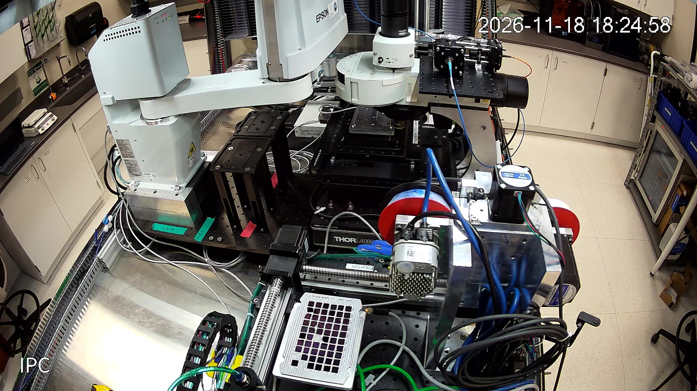
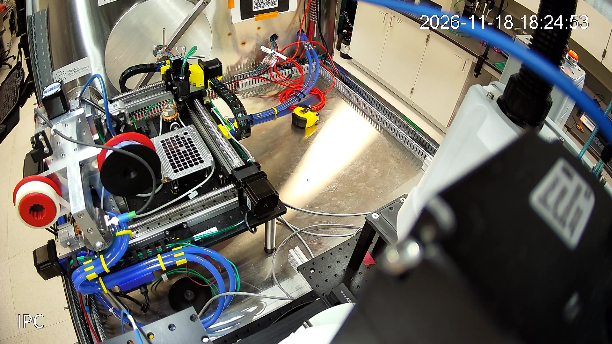

# Aurora security cameras → Pi 5 → YouTube

Streaming the two glovebox-area **Amcrest security cameras** to YouTube through
the **Pi 5** (the ex-OT-2 overhead HQ camera, now the "cataloging stage
overhead" stream). The Pi 5 reaches the cameras through an Ethernet switch on
its `eth0`. This follows the 2026-11-06 analysis in issue #23
([comment](https://github.com/borysgroup/aurora-cloud-infra/issues/23#issuecomment-6697495676)).

## Status (2026-11-19)

- **Access works.** Both cameras accept the `relay` viewer login over RTSP and
  the admin login over HTTP (used read-only).
- **Feeds pulled.** Both main streams are H.264 1920x1080 at 20 fps, about
  4.2 Mbit/s CBR, with a keyframe every 2.0 s. That already matches YouTube's
  ingest recommendations, so no camera setting was changed.
- **Relayed to YouTube.** [`amcrest_relay.py`](amcrest_relay.py) on the Pi 5
  copies each camera's H.264 to its own broadcast from the picam Lambda.
  Both broadcasts are **unlisted** and live with stream health "good", and each
  sits in its own **private** playlist.
- **Test run, not installed.** The relays run as transient systemd units until
  the Pi's scheduled 21:00 MST reboot (04:00 UTC). After that the Pi is back to
  how it was. [Making it permanent](#making-it-permanent) needs the static
  `eth0` address confirmed (item 4 under [Still open](#still-open)).
- **No pan/tilt/zoom.** The cameras report no PTZ, motorized zoom or focus;
  see [Angle and image controls](#angle-and-image-controls).

## Stills (2026-11-19 00:23 UTC)

One main-stream frame from each camera, pulled with the viewer login
(`pull_feed.py N still`). No one was in either frame. The burned-in clock reads
an hour ahead of Mountain time (see [Camera clocks](#camera-clocks)).

| `192.168.3.150` (cams.env slot `_0`) | `192.168.3.151` (slot `_1`) |
|---|---|
|  |  |
| Wide view: the Epson SCARA arm, the microscope/optics stage and the sample tray | Close view: the XY gantry with the sample tray; an out-of-focus object blocks the lower right |

## Camera settings (read 2026-11-19, nothing changed)

Read with [`read_camera_config.py`](read_camera_config.py) (admin login over
stdin, `getConfig`/`getCaps` only). Both cameras are configured identically:

| Stream | Enabled | Codec | Size | fps | GOP | Rate control | Bitrate |
|---|---|---|---|---|---|---|---|
| Main (`subtype=0`) | yes | H.264 Main | 1920x1080 | 20 | 40 (2 s) | CBR | 4096 kbit/s |
| Sub 1 (`subtype=1`) | **no** | H.264 Main | 704x480 | 20 | 40 | CBR | 512 kbit/s |
| Sub 2 (`subtype=2`) | **no** | H.264 Main | 704x480 | - | - | CBR | 1024 kbit/s |

Audio is disabled on every stream (`AudioEnable=false`). The sensor is 5 MP,
but the main stream is set to 1080p.

Measured over 12 s on the Pi 5 ([`pull_feed.py`](pull_feed.py) `N packets 12`):
19.97 fps, 4208 and 4270 kbit/s, keyframes exactly 2.0 s apart, no B-frames.

Other settings seen:

- **On-screen text:** channel title `IPC` (the default) bottom left, date and
  time top right. A title per camera would identify the feeds on YouTube.
- **Image:** `Flip=false`, `Mirror=false`, `Rotate90=0`, infrared off,
  day/night auto.
- **Sessions:** the cameras' active-user list showed only the read itself, so
  no web UI or SDK client (such as an NVR) was logged in. RTSP clients don't
  appear in that list (the relays' own sessions didn't), so it can't rule out
  another RTSP viewer.

### Camera clocks

Both cameras read 18:22 when it was 17:22 MST on the Pi, so their clocks (and
the burned-in timestamp) are **one hour ahead of Mountain Standard Time**, most
likely still on daylight time. The cameras have no internet path and so no NTP,
and the two already differ by several seconds. Not changed. The fix is the time
zone/DST setting in the web UI (*Setup → System → General → Date & Time*), or
NTP served to the segment from the Pi.

### Angle and image controls

The cameras can't be aimed remotely. Each reports:

- `ptz.cgi?action=getStatus` → `400 Bad Request`, and the PTZ protocol caps hold
  only `AutoFocus=false`.
- `devVideoInput.cgi?action=getCaps`: `ElectricFocus=false`, `Iris=false`,
  `SyncFocus=false` (fixed lens, no motorized zoom or focus), but `Flip=true`,
  `Mirror=true`, `Rotate90=true`.
- ONVIF lists no PTZ service (only `device`, `media`, `media2`, `imaging`,
  `analytics`, `events`).

So the view only changes by hand, by loosening the turret and re-aiming it.
Remotely, the image can be flipped, mirrored or rotated 90°, and exposure,
day/night and infrared can be changed. A "digital zoom" would mean cropping on
the Pi, which needs a re-encode instead of the copy relay.

## Relay to YouTube

### How it works

[`amcrest_relay.py`](amcrest_relay.py) runs on the Pi 5, one instance per
camera:

1. Probes the camera (about 3 s). If it doesn't answer, it exits without asking
   for a broadcast, so a camera that is down leaves no empty scheduled
   broadcasts behind.
2. Calls the picam Lambda (the one in the Pi 5's `my_secrets.py`) with `end`,
   then `create`, as `device.py` does. The Lambda creates the stream key and
   the broadcast and adds the broadcast to the workflow's playlist.
3. Runs `ffmpeg`: RTSP over TCP in, `-c:v copy` (no decode or encode), a silent
   AAC track added (`anullsrc`, 128 kbit/s, because YouTube expects audio), FLV
   out to YouTube's **RTMPS** ingest.
4. Restarts `ffmpeg` against the same broadcast if it exits or makes no
   progress for 60 s. The broadcast has auto-stop off, so it resumes. After 5
   quick failures in a row it exits and leaves the next step to systemd.
5. Ends and replaces its broadcast after 11 h, so none runs past YouTube's
   12 h archive limit even when the Pi's 8-hourly reboot is held off.
6. On `SIGTERM` (stop or reboot) it stops `ffmpeg` and calls `end`, so the
   broadcast closes cleanly and its archive is kept.

`--test-output FILE` writes a short local FLV instead (no Lambda calls), for
checking the camera side.

### Secrets

- **Viewer login:** read from `~/.config/aurora-security-cams/cams.env` on the
  Pi. `ffmpeg` gets the camera through an `ffconcat` file (mode 600, in a
  mode-700 runtime directory) holding the credentialed RTSP URL, so the login
  never appears on a command line or in the process list. ffmpeg 7.1 can't
  load `-i` from a file (`-/i` is rejected). The concat demuxer's `option`
  lines carry `rtsp_transport tcp` and the socket timeout through (checked:
  the relays' `ffmpeg` has no UDP sockets).
- **Lambda URL:** parsed (not imported) from the picam's `my_secrets.py`, or
  taken from `$LAMBDA_FUNCTION_URL`.
- **Logs:** every line `ffmpeg` prints is redacted (RTSP logins, stream keys,
  video IDs), and the relay never logs the stream key, video ID or broadcast
  URL, so the journal is safe to read out. (`device.py` itself does print its
  stream URL to the journal.)

### Playlist privacy

The Lambda adds each new broadcast to the first playlist whose title contains
the workflow name. Only if none exists does it create
`"<workflow> Livestreams Playlist"`, **with the broadcast's privacy**. So a new
workflow's first `create` decides the playlist's privacy for good. To get a
private playlist with unlisted broadcasts, as the picam devices have:

1. Run the relay once with `--privacy private`: this creates the private
   playlist (and a short private test broadcast).
2. From then on, run it with `--privacy unlisted` (the default).

A cleaner fix would be an optional `playlist_privacy_status` field in
`create_broadcast_and_bind_stream` in
[`borysgroup/streamingLambda`](https://github.com/borysgroup/streamingLambda/blob/main/chalicelib/ytb_api_utils.py)
(default `private`).

### Names

| Slot | Camera | `CAM_NAME` | `WORKFLOW_NAME` (and playlist) |
|---|---|---|---|
| `_0` | `192.168.3.150` | `amcrest-150` | `Aurora security cam 150` |
| `_1` | `192.168.3.151` | `amcrest-151` | `Aurora security cam 151` |

These are placeholders until the cameras' roles are settled (item 1 under
[Still open](#still-open)). The Lambda matches **substrings** for both `end`
(which ends every live broadcast whose title contains the workflow name) and
the playlist lookup. So a workflow name must not contain, or be contained in,
another device's name. For example `Cataloging stage overhead camera 2` would
let the picam's `end` end it, and `aurora` alone would end every picam
broadcast. Renaming later starts a new playlist.

### Why RTMPS, and what it costs

The Pi 5's `stream-watchdog.sh` restarts `device.service` when the RTMP
**port 1935** socket with the most bytes ACKed stops growing. A relay on port
1935 could hide a stalled picam stream, or, once it stalls itself, make the
watchdog restart a healthy picam stream. So the relay rewrites the Lambda's
`rtmp://a.rtmp.youtube.com/live2/<key>` to
`rtmps://a.rtmps.youtube.com:443/live2/<key>` (same key). During the test,
`ss` showed exactly one port-1935 socket (the picam's), and the watchdog
logged nothing.

The cost is upload. Each relay sends about **5.7 Mbit/s** for a 4.4 Mbit/s
camera feed, about 28 % more. That fits ffmpeg's RTMP client writing 128-byte
chunks, each of which becomes its own TLS record (about 29 bytes of overhead).
Plain RTMP should need about 4.6 Mbit/s per camera (an estimate, not
measured). To get that back, make the
watchdog look only at the picam's own socket (add
`cgroup /system.slice/device.service` to its `ss` filter), then run the relays
with `--no-rtmps`. That changes the picam's watchdog, so it was not done here.

### Measured on the Pi 5 (2026-11-19, both relays running)

| | Before | With both relays |
|---|---|---|
| `wlan0` upload | 0.6 Mbit/s | 12.5 Mbit/s (5.7 + 5.7 relays, 0.64 picam, plus TCP/IP) |
| `eth0` download | 0 | 8.8 Mbit/s |
| Load average | 0.08 | 0.08 to 0.3 |
| Relay CPU | | about 3 % of one core each (copy, plus AAC of silence) |
| SoC temperature | 51.8 °C | 52.7 °C |
| TCP retransmits on the YouTube sockets | | under 0.1 % |
| Picam on YouTube | health `ok`, `bitrateLow` | unchanged (`ok`, `bitrateLow`) |
| `device.service` | 0 restarts | 0 restarts |

Wi-Fi was 5.8 GHz at -34 dBm with an 86.6 Mbit/s link rate. Both relays held
stream health `good`. The only issue YouTube raised was `audioBitrateLow` (the
silent track), which the picams get too. In total the relays add about
11 Mbit/s of sustained upload, roughly 5 GB per hour.

### What the test left on YouTube

On *Aurora PCL Hardware Streams*, two new **private** playlists,
`Aurora security cam 150 Livestreams Playlist` and
`Aurora security cam 151 Livestreams Playlist`, each with:

1. a private test broadcast of about a minute (the run that created the private
   playlist),
2. an unlisted broadcast of about 5 minutes, ended when the relay was restarted
   on its final code,
3. the unlisted broadcast that is live until the 21:00 MST reboot.

The upload token can't delete or edit videos, and nothing was deleted.

## Pi 5 state after this session

- **Running:** transient units `amcrest-relay-0` and `amcrest-relay-1` (made by
  `systemd-run`, run as `vcl`, `Restart=always`, at most 3 starts an hour,
  `Nice=10`). No unit files are on disk and nothing is enabled.
- **Files:** `amcrest_relay.py` in `/tmp/aurora-cams/` (tmpfs).
- **`eth0`:** the unsaved, gateway-less `cam-probe` profile,
  `192.168.3.199/24`, `ipv4.never-default yes`, no IPv6. The default route is
  still `wlan0`, and `ip_forward=0`.
- **Unchanged:** `device.service`, both stream timers, the cameras' settings.

At the scheduled 21:00 MST (04:00 UTC) reboot, the relays end their broadcasts
through the Lambda, `/tmp` is wiped, the `cam-probe` profile disappears and
`eth0` goes back to having no address. There is nothing to undo by hand. To
stop sooner:

```bash
sudo systemctl stop amcrest-relay-0 amcrest-relay-1   # ends both broadcasts
sudo nmcli connection delete cam-probe
```

## Making it permanent

Not done yet: it needs the `eth0` address confirmed (item 4), and
`CLAUDE.md`'s "eth0 has no address by default" would need updating. The units
are in [`systemd/`](systemd/):

- [`amcrest-eth0.service`](systemd/amcrest-eth0.service) creates the same
  unsaved, gateway-less profile at each boot. Nothing about `eth0` is written to
  disk.
- [`amcrest-relay@.service`](systemd/amcrest-relay@.service), one instance per
  cams.env slot, with names from
  [`relay-0.env`](systemd/relay-0.env) / [`relay-1.env`](systemd/relay-1.env).

```bash
# on the Pi 5, from a checkout of this directory
mkdir -p ~/aurora-security-cams && cp amcrest_relay.py ~/aurora-security-cams/
install -m 600 systemd/relay-0.env systemd/relay-1.env ~/.config/aurora-security-cams/
sudo cp systemd/amcrest-eth0.service systemd/amcrest-relay@.service /etc/systemd/system/
sudo systemctl daemon-reload
sudo systemctl enable --now amcrest-eth0.service amcrest-relay@0.service amcrest-relay@1.service
```

The playlists already exist and are private, so the units run `unlisted` from
the start. Each reboot (05:00, 13:00, 21:00) then starts fresh broadcasts, as
for the picam.

## Earlier findings

### The camera segment (2026-11-11)

The switch is **not** an isolated two-camera island. It is a real
`192.168.3.0/24` network with about 9 hosts:

| Host | Vendor (OUI) | What it is |
|---|---|---|
| `192.168.3.150` | Amcrest | Security camera, slot `_0` |
| `192.168.3.151` | Amcrest | Security camera, slot `_1` |
| about 7 others | Dell / Lenovo-class / TI / others | PCs / NVR / lab devices (not probed) |
| `192.168.3.1` | none | Gateway the cameras ARP for, but **nothing answered**: no working router on this segment |

With no live gateway, the cameras have no path to the internet, so their
Dahua-based firmware can't be reached from outside and can't phone home. The
relay keeps it that way (no NAT, `ip_forward=0` on the Pi).

By default `eth0` is up at 1 Gb/s full duplex with **no IP** (its
NetworkManager/netplan profile is DHCP, and there is no DHCP server on the
segment). For each session it gets a temporary, in-memory address
(`192.168.3.199/24`, `ipv4.never-default yes`, `save no`, and since
2026-11-19 duplicate-address detection) that disappears on reboot.

### The two cameras

- **Model:** Amcrest **IP5M-T1179EW-AI-V3** (5 MP turret, Dahua OEM),
  firmware `2.880.00AC003.0.R`, build 2025-03-19.
- **Open TCP ports:** `80` (web UI and CGI), `554` (RTSP, Digest auth),
  `37777` (Dahua SDK).
- **ONVIF:** Profile S on `/onvif/device_service`.
- **Latency:** about 0.3 ms round trip from the Pi 5.
- **RTSP URL:**
  `rtsp://<user>:<pass>@192.168.3.15x:554/cam/realmonitor?channel=1&subtype=0`
  (main stream). Never put a real one on a command line or in a log.

### Viewer accounts (2026-11-18)

Using the admin login, a non-admin `relay` account was created on each camera
for the YouTube relay.

- **What was changed on the cameras:** one new user per camera, `relay`, group
  `user`, `Sharable=true` (concurrent sessions allowed), memo `youtube-relay`,
  created with `userManager.cgi?action=addUser`. The request asked for
  `Monitor_01` (live view) only, but the firmware applied the group's full
  rights, so the account holds `Monitor_01` + `Replay_01` (live view and
  playback of recordings). It has no configuration, user-management or network
  rights: the user-management API answers it with `403`. The `admin` account is
  untouched.
- **Where the credentials live:** repo variables `AMCREST_CAM_USERNAME_<n>` and
  secrets `AMCREST_CAM_PASSWORD_<n>` (`_0` = `.150`, `_1` = `.151`), and on the
  Pi 5 in `~/.config/aurora-security-cams/cams.env` (directory `700`, file `600`,
  owner `vcl`), which holds `AMCREST_CAM_{HOST,USERNAME,PASSWORD}_<n>`. The
  admin logins (`AMCREST_CAM_ADMIN_{USERNAME,PASSWORD}_<n>`) are not stored on
  the Pi.
- **To undo:** `userManager.cgi?action=deleteUser&name=relay` with the admin
  login on each camera, and delete the `cams.env` directory on the Pi 5.

## Still open

1. **What each camera is for:** names and titles for YouTube (now
   placeholders), and optionally the on-screen title (`IPC` now). The stills
   above show what each one sees.
2. **Audio:** the relay sends silence. The cameras have microphones, but audio
   is disabled in their encoder settings. Enabling it is a camera change, and
   the relay would then copy it instead of adding silence.
3. **Camera clocks:** fix the one-hour offset (time zone/DST), and decide
   whether the Pi should serve them NTP.
4. **A static `eth0` address for the Pi** (`.199` so far, never saved), and
   confirmation that the dead `.1` gateway is intentional. This is what
   [making it permanent](#making-it-permanent) waits on.
5. **Upload budget:** about 11 Mbit/s for both cameras over RTMPS. If that is
   too much, use the watchdog change above (about 9 Mbit/s), lower the cameras'
   main-stream bitrate, or enable and relay a sub-stream.

## Files

- [`amcrest_relay.py`](amcrest_relay.py): the relay (runs on the Pi 5).
- [`systemd/`](systemd/): units and per-camera settings for a permanent install.
- [`pull_feed.py`](pull_feed.py): probe a feed, measure it, or grab a still,
  with the viewer login from `cams.env`.
- [`read_camera_config.py`](read_camera_config.py): read-only dump of the
  encoder, image and PTZ settings, with the admin login over stdin.
- [`probe_camera_link.py`](probe_camera_link.py): the read-only network recon
  from 2026-11-11 (`sniff` / `sweep` / `probe` / `discover`). It never sends
  credentials.
- [`captures/`](captures/): the stills above.
